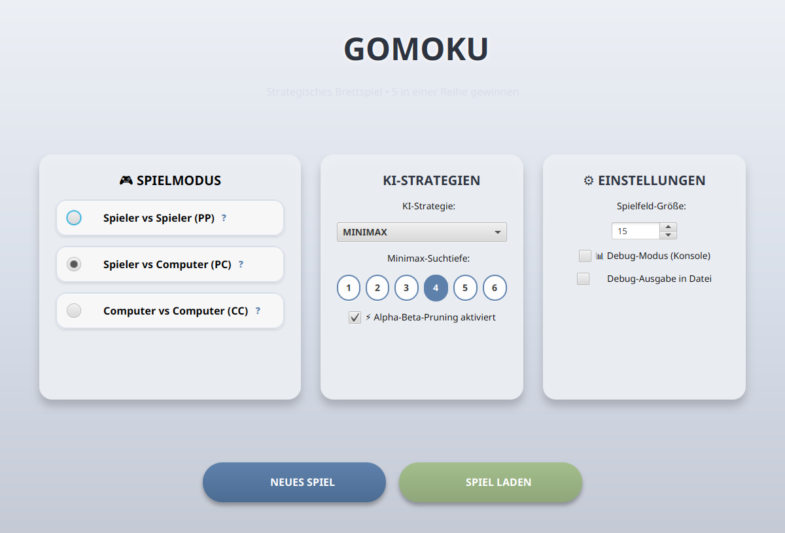
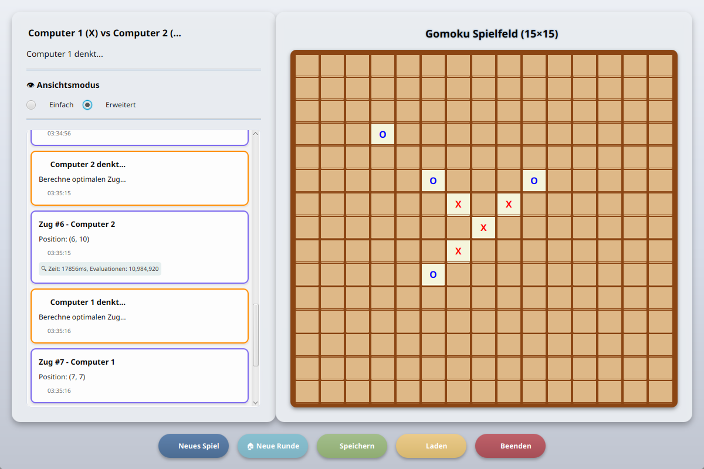

**English** | [Deutsch](README.de.md)

# 🎮 Gomoku – Five in a Row (JavaFX) ⚫⚪

A JavaFX implementation of **Gomoku** (Five-in-a-Row) with three AI opponents – from random moves up to a
**Minimax search with alpha-beta pruning** – playable in a modern GUI or straight from the console. Built with
**Java 17**, **JavaFX** and **Maven**.

| 🏠 Start screen | ♟️ Game in progress (computer vs computer) |
|---|---|
|  |  |

## 📋 Requirements

- Java 17+
- No Maven installation needed – the Maven wrapper is included

## 🚀 Build & Run

```bash
# Build the executable JAR (Windows: mvnw.cmd package)
./mvnw package

# Run the JAR
java -jar target/gomoku-1.0.0-executable.jar
```

## 💻 Command-Line Arguments

You can skip the start screen and launch a game directly. Arguments may appear in any order and are validated with
**regular expressions**.

| Argument | Description |
|----------|-------------|
| *(none)* | Opens the start screen |
| `PP` | Player vs Player |
| `PC` | Player vs Computer |
| `CC` | Computer vs Computer |
| `S1` / `S2` / `S3` | AI strategy (one per computer player) |
| `D` | Debug output to the console |
| `DF` | Debug output to a file |
| `Go` | Play the chosen setup in the GUI instead of the console |

**🤖 AI Strategies:**

| Code | Name | Uses depth | Description |
|------|------|------------|-------------|
| `S1` | 🎲 Random | No | Random moves, limited to the area around existing stones |
| `S2` | 🛡️ Rule-based | No | Completes its own lines and blocks the opponent's threats |
| `S3` | 🧠 Minimax | Yes | Minimax search with alpha-beta pruning and a heuristic board evaluation |

The search depth (1–6, default 4) is chosen on the start screen and applies only to S3.

**📝 Examples:**

```bash
java -jar target/gomoku-1.0.0-executable.jar PP                # Player vs Player on the console
java -jar target/gomoku-1.0.0-executable.jar PC S3 D           # against Minimax, with debug output
java -jar target/gomoku-1.0.0-executable.jar Go CC S2 S3       # GUI: rule-based AI vs Minimax
```

## 📁 Project Structure

```
de.hsh.oil.gomoku/
├── Main.java, GomokuApplication.java   Entry points, parameter handling
├── model/        Board, players, moves, configuration, save games, statistics
├── controller/   SpielController – game flow, turn order, win detection
├── view/         GuiView, WelcomeView (JavaFX), KonsoleView (terminal)
├── strategy/     ZugStrategie interface + random, rule-based and Minimax strategies
└── util/         ParameterValidator (regex), StrategieFactory, XmlSaveManager, DebugLogger
```

## 🧩 Design Patterns

| Pattern | Where |
|---------|-------|
| **MVC** | `model` / `view` / `controller` are fully separated – the same game logic drives the GUI and the console |
| **Strategy** | `ZugStrategie` – AI algorithms swapped without changing the controller |
| **Factory** | `StrategieFactory` maps the codes `S1`–`S3` to strategy instances |

## ✨ Game Features

- 📐 Configurable board size from 10×10 to 20×20 (default 15×15)
- ⚫ Standard Gomoku rules – five in a row wins, horizontally, vertically or diagonally
- 🎮 Three game modes: Player vs Player, Player vs Computer, Computer vs Computer
- 🧠 Adjustable Minimax search depth (1–6)
- 📜 **Move log** with the position of every move – and for every AI move its computing time and the number of
  evaluated positions (over **10 million** for a single move in my tests)
- 💾 Save/load games as XML (JAXB), including the move history and win/draw statistics
- 🐛 Debug mode – console output (`D`) or a log file (`DF`)
- 🖥️ Console mode for playing directly in the terminal
- 🪟 Windows `.exe` via Launch4j (`build-exe.bat`, see [BUILD-README.md](BUILD-README.md))

The interface is in German.
